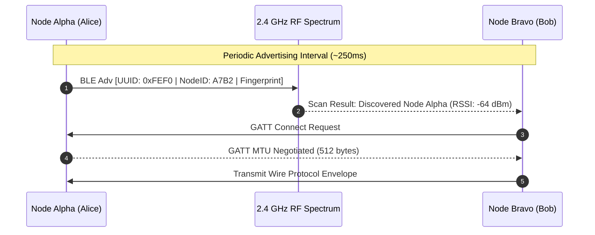
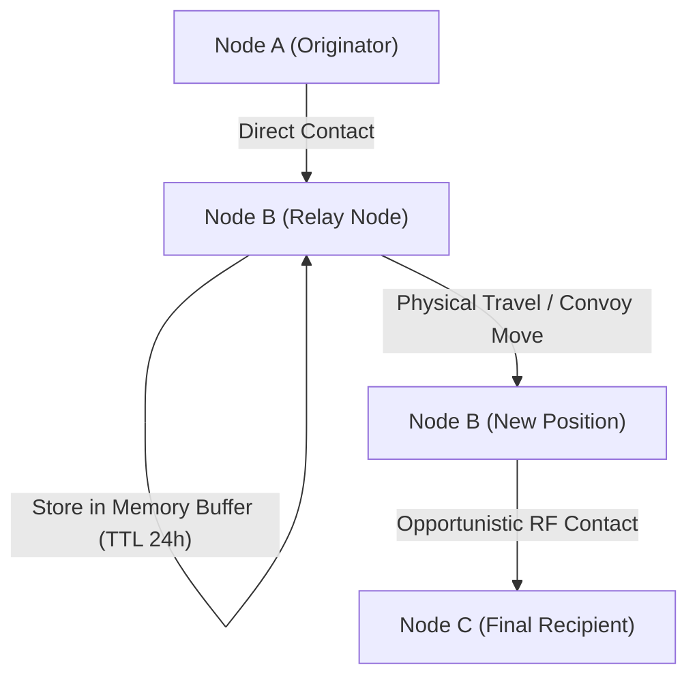
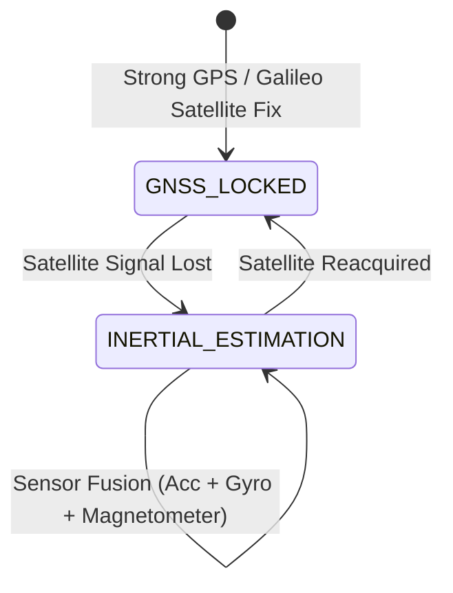

# 🧠 How NOMAD LINK Works — Deep-Dive Technical Manual

> **No Signal. No Limits. Zero Central Infrastructure.**  
> An in-depth technical breakdown of how NOMAD LINK creates an autonomous, encrypted, delay-tolerant mesh network and navigation system using standard consumer Android hardware.

---

## 📑 Table of Contents
1. [Core Architectural Philosophy](#1-core-architectural-philosophy)
2. [Physical Layer & Decentralized RF Discovery](#2-physical-layer--decentralized-rf-discovery)
3. [Cryptographic Identity & Zero-Trust Envelope](#3-cryptographic-identity--zero-trust-envelope)
4. [Delay-Tolerant Networking (DTN) & Mesh Routing](#4-delay-tolerant-networking-dtn--mesh-routing)
5. [Sensor Fusion & Inertial Dead Reckoning](#5-sensor-fusion--inertial-dead-reckoning)
6. [Background Relay Service & Power Management](#6-background-relay-service--power-management)
7. [Emergency SOS Beacon Flood Lifecycle](#7-emergency-sos-beacon-flood-lifecycle)
8. [End-to-End Packet Journey Walkthrough](#8-end-to-end-packet-journey-walkthrough)

---

## 1. Core Architectural Philosophy

Traditional communication networks rely on a **hierarchical client-server topology** requiring base stations, cell towers, satellite ground uplinks, and DNS root servers. When an expedition team enters a subterranean canyon, a mountain pass, or a disaster zone, that entire infrastructure collapses.

NOMAD LINK operates on a **Pure Ad-Hoc Peer-to-Peer (P2P)** paradigm:
- **Every device is simultaneously an endpoint, a router, and a cryptographic vault.**
- **Asynchronous & Opportunistic:** Nodes do not need a continuous, active end-to-end route to communicate. If two nodes are out of range, intermediate moving nodes carry packets until proximity is established (**Store-and-Forward DTN**).
- **Zero-Knowledge Relays:** Intermediary nodes forward packets blindly without the ability to inspect payload contents or alter metadata without detection.

```
[ Traditional Cellular ]           [ NOMAD LINK Mesh Topology ]
       (Tower)                                (Node A)
      /   |   \                                 /  \  BLE
   (A)   (B)  (C)                        (Node B)---(Node C)
  [Failure Point: Tower]                     \       / Wi-Fi Direct
                                              (Node D)
```

---

## 2. Physical Layer & Decentralized RF Discovery

NOMAD LINK leverages two complementary short-to-medium range consumer radio technologies on Android:

| Radio Protocol | Primary Function | Theoretical Range | Bandwidth | Power Profile |
| :--- | :--- | :--- | :--- | :--- |
| **Bluetooth LE (BLE 5.0+)** | Continuous discovery, beaconing, mesh telemetry, chat envelopes | 30m – 100m | ~1–2 Mbps | Very Low (~15–30 mA) |
| **Wi-Fi Direct (P2P Sockets)**| High-speed file transfers, map tile sharing, bulk convoy telemetry | 80m – 150m | ~10–50 Mbps | Medium (~100–250 mA) |

### 2.1 BLE Peripheral Advertising & Scanning
The BLE engine (`NomadBleModule.kt`) operates in dual-mode concurrently:
1. **Peripheral Mode (Advertiser):**
   - Broadcasts customized BLE Advertising Packets containing NOMAD LINK's 16-bit Service UUID (`0xFEF0`).
   - The Manufacturer Data payload embeds the node's truncated public key fingerprint, battery status, and node alias.
2. **Central Mode (Scanner):**
   - Continuously scans for neighboring `0xFEF0` advertisements.
   - Measures received signal strength (RSSI) in dBm to derive proximity and connection stability.
   - Triggers automated GATT connection establishment when an envelope needs transmission.



### 2.2 Wi-Fi Direct Dynamic Group Formation
When large payloads (voice notes, waypoint packages, offline map slices) exceed BLE throughput:
- `NomadWifiDirectModule.kt` negotiates a temporary Wi-Fi P2P Group.
- One node is elected as **Group Owner (GO)** providing an autonomous DHCP subnet (`192.168.49.1`).
- High-speed TCP sockets transfer data and gracefully terminate to return the radio to low-power BLE mode.

---

## 3. Cryptographic Identity & Zero-Trust Envelope

Security in an off-grid hostile mesh cannot rely on Certificate Authorities (CAs) or PKI servers. NOMAD LINK implements a **Self-Sovereign Identity Architecture** based on modern Edwards-curve cryptography (`CryptoEngine.ts`):

```
+--------------------------------------------------------------------------+
|                     NOMAD LINK CRYPTOGRAPHIC SUITE                       |
+--------------------------------------------------------------------------+
|  Identity & Digital Signatures:       Ed25519 (256-bit elliptic curve)   |
|  Key Agreement (ECDH):                X25519 (Curve25519)                |
|  Symmetric AEAD Cipher:               ChaCha20-Poly1305 / AES-256-GCM    |
|  Hardware Keystore Binding:           Android Keystore (StrongBox / TEE) |
|  Out-of-Band Safety Number:           12-Digit Commutative Fingerprint   |
+--------------------------------------------------------------------------+
```

### 3.1 Key Lifecycle & Hardware Binding
1. **Root Key Generation:** At first launch, `NomadNativeBridgeModule.kt` calls `KeyGenParameterSpec` inside the Android Hardware Keystore (TEE or StrongBox chip). Private keys cannot be extracted in plaintext even if the operating system is compromised.
2. **Ephemeral Session Ratchet:** Every direct communication session computes a shared secret via $K = \text{X25519}(sk_{\text{Alice}}, pk_{\text{Bob}})$. This shared secret derives unique session encryption and authentication keys.
3. **Payload Sealing:** The message text, timestamps, and coordinates are encrypted using ChaCha20-Poly1305. The authenticated Poly1305 MAC tag guarantees tamper-evidence.

### 3.2 Commutative 12-Digit Safety Fingerprint
To prevent Man-in-the-Middle (MitM) attacks during local mesh formation, users can verify each other out-of-band using a 12-digit safety number:
$$\text{Fingerprint} = \text{SHA256}(\min(pk_A, pk_B) \parallel \max(pk_A, pk_B)) \pmod{10^{12}}$$
Because the public keys are sorted lexicographically before hashing, Alice looking at Bob's device and Bob looking at Alice's device see the **exact same 12-digit number** (e.g. `2120 4840 7560`).

---

## 4. Delay-Tolerant Networking (DTN) & Mesh Routing

In harsh physical environments, end-to-end paths are intermittent. NOMAD LINK implements a **Bounded Store-and-Forward Epidemic Router** (`BoundedMeshRouter.ts`):



### 4.1 Binary Wire Protocol Envelope Framing
All mesh messages are framed into a compact binary format with zero JSON overhead (`WireProtocol.ts`):

```
+------------+-------------+---------------+------------------+------------------+----------+---------+----------+---------------------+
| MAGIC BYTE | VERSION (1B)| MESSAGE ID    | SENDER PUBKEY    | DEST PUBKEY      | HOP COUNT| MAX HOPS| PRIORITY | CIPHERTEXT + MAC    |
| 0x4E ('N') | 0x01        | 16 Bytes UUID | 32 Bytes Ed25519 | 32 Bytes Ed25519 | 1 Byte   | 1 Byte  | 1 Byte   | N Bytes (Encrypted) |
+------------+-------------+---------------+------------------+------------------+----------+---------+----------+---------------------+
```

### 4.2 Loop Defense & Deduplication Cache
- **Hop Count Enforcement:** Each forwarding node increments `HOP COUNT`. If `HOP COUNT >= MAX HOPS` (default: 7), the packet is dropped immediately to prevent infinite bandwidth storms.
- **LRU Deduplication Index:** Nodes maintain an in-memory hash index of the last 1,000 received message IDs. If a duplicate packet arrives via another route, it is silently dropped in $\mathcal{O}(1)$ time.

### 4.3 Bounded Buffer & Eviction Hierarchy
If the local buffer reaches its capacity limit (e.g. memory constraint):
- **Priority 255 (SOS Distressed Packets):** **NEVER** evicted.
- **Priority 100 (Convoy Waypoints & Telemetry):** Evicted only after chat.
- **Priority 10 (Direct Messages / P2P Chat):** Evicted using Least-Recently-Used (LRU) policy when queue is saturated.

---

## 5. Sensor Fusion & Inertial Dead Reckoning

Satellite navigation fails inside tunnels, mountain slot canyons, heavy tree canopies, or GPS jamming environments. NOMAD LINK integrates hardware inertial sensors to provide continuous navigation (`DeadReckoningEngine.ts` & `NomadSensorModule.kt`).



### 5.1 Mathematical Drift & Uncertainty Model
When GNSS lock is lost, the position is calculated iteratively from sensor delta vectors:
$$\mathbf{P}_{t} = \mathbf{P}_{t-1} + \mathbf{v}_{t} \cdot \Delta t + \frac{1}{2} \mathbf{a}_{t} \cdot (\Delta t)^2$$
Where heading angle $\theta$ is extracted from the 3-axis magnetometer compensated by gyroscope angular rate.

To honestly inform the operator of sensor drift, the **Confidence Score** decays exponentially:
$$C(t) = C_0 \cdot e^{-\lambda t}$$
Concurrently, the **Uncertainty Radius ($R_u$)** expands dynamically:
$$R_u(t) = R_{\text{GNSS}} + (v_{\text{drift}} \cdot t)$$
The tactical UI renders this expanding circular safety perimeter directly on the HUD so search and rescue teams know the exact boundary of location accuracy.

---

## 6. Background Relay Service & Power Management

A mesh network only functions if participant devices relay packets even when stored in a pocket or backpack. 

### 6.1 Persistent Android Foreground Service
- `NomadForegroundService.kt` launches an Android Foreground Service displaying an ongoing notification (`NOMAD LINK Mesh Active`).
- Acquires a low-power `PARTIAL_WAKE_LOCK` to prevent aggressive OEM operating systems from freezing the radio hardware.

### 6.2 Expedition Battery Eco-Duty-Cycle
Continuous radio scanning drains battery rapidly. NOMAD LINK implements configurable adaptive duty-cycling:

```
[ STANDARD MODE (High Responsiveness) ]
|--- 1000ms SCAN ---|--- 250ms REST ---|--- 1000ms SCAN ---|  (~85% Duty Cycle)

[ EXPEDITION ECO-MODE (Multi-Day Survival) ]
|-- 250ms SCAN --|-------- 2250ms SLEEP --------|-- 250ms SCAN --|  (~10% Duty Cycle)
```
In Expedition Eco-Mode, battery consumption drops by over 70%, extending operational battery life to several days while maintaining mesh connectivity.

---

## 7. Emergency SOS Beacon Flood Lifecycle

When an operator triggers an emergency distress beacon:

1. **Envelope Crafting:** The device captures the last valid GNSS fix or Dead Reckoning coordinate, current timestamp, SITREP category (`MEDEVAC`, `SEARCH_AND_RESCUE`, `BREAKDOWN`, `GENERAL`), and freeform medical notes.
2. **Priority Elevation:** The envelope is stamped with `PRIORITY = 255` and `MAX_HOPS = 12`.
3. **Flood Transmission:** The SOS packet bypasses standard throttling queues and is broadcast immediately over all available radio interfaces simultaneously (BLE Advertising, BLE GATT, Wi-Fi Direct).
4. **Mesh Relay Immunity:** Every receiving node in the network places this packet at the top of its outbound queue, regardless of available memory, ensuring rapid multi-hop propagation across the entire valley or convoy.

---

## 8. End-to-End Packet Journey Walkthrough

```
[ ALICE (Originator) ]                 [ BOB (Moving Relay) ]                [ CHARLIE (Destination) ]
       |                                       |                                         |
   1. Types msg & taps TX                      |                                         |
   2. ChaCha20 AEAD Encrypt                    |                                         |
   3. Framed as 0x4E Envelope                  |                                         |
       |                                       |                                         |
       |------- BLE Advertised (RSSI: -72) --->|                                         |
       |                                 4. Checks Dedup Cache (New)                     |
       |                                 5. Stored in DTN Queue                          |
       |                                       |                                         |
       |                                 [ Bob travels 800m ]                            |
       |                                       |                                         |
       |                                       |------- BLE Scan detects Charlie ------->|
       |                                       |        (GATT Connection Opened)         |
       |                                       |                                         |
       |                                       |--- Forward Wire Protocol Envelope ----->|
       |                                       |                                   6. Dedup verifies ID
       |                                       |                                   7. Authenticates MAC
       |                                       |                                   8. Decrypts with PrivKey
       |                                       |<-- ACK Receipt Returned ----------------|
       |                                 9. Marks as Delivered                           |
```

1. **Origin (Alice):** Alice drafts a message to Charlie. Alice's node encrypts the text using Charlie's public key and seals it in a binary envelope (`0x4E`).
2. **Transfer to Relay (Bob):** Charlie is 2 kilometers away over a mountain ridge (out of radio range). However, Bob is riding a motorcycle between them. Alice's phone transmits the envelope to Bob via BLE.
3. **Store & Carry:** Bob's phone validates the envelope header, sees that Charlie is the destination, and stores the encrypted blob in its bounded memory buffer.
4. **Delivery (Charlie):** 15 minutes later, Bob arrives at Charlie's camp. Bob's phone discovers Charlie's BLE beacon, automatically connects, and flushes the queued envelope.
5. **Decryption:** Charlie's phone validates the cryptographic MAC tag, decrypts the payload with his private key, and renders the message with hop telemetry `HOP 2/7`.

---

## 📚 Technical Documentation Cross-References

For source code implementations and granular specifications, refer to the following companion guides:

- **[ARCHITECTURE.md](file:///d:/projects%20and%20certificates/projects/apps/NOMAD%20LINK/docs/ARCHITECTURE.md)** — Architectural layers, dependency inversion, and clean code boundaries.
- **[NETWORK_PROTOCOL.md](file:///d:/projects%20and%20certificates/projects/apps/NOMAD%20LINK/docs/NETWORK_PROTOCOL.md)** — Low-level MTU chunking, binary wire framing, and opcode specifications.
- **[CRYPTOGRAPHY.md](file:///d:/projects%20and%20certificates/projects/apps/NOMAD%20LINK/docs/CRYPTOGRAPHY.md)** — Key derivations, Android Keystore StrongBox binding, and cryptographic proofs.
- **[THREAT_MODEL.md](file:///d:/projects%20and%20certificates/projects/apps/NOMAD%20LINK/docs/THREAT_MODEL.md)** — Formal attack vectors, Sybil defense, replay mitigation, and side-channel analysis.
- **[OFFLINE_NAVIGATION.md](file:///d:/projects%20and%20certificates/projects/apps/NOMAD%20LINK/docs/OFFLINE_NAVIGATION.md)** — Sensor fusion formulas, Kalman filter state matrix, and SQLite map caching.
- **[TESTING.md](file:///d:/projects%20and%20certificates/projects/apps/NOMAD%20LINK/docs/TESTING.md)** — Physical multi-device field testing runbook and procedure.
- **[KNOWN_LIMITATIONS.md](file:///d:/projects%20and%20certificates/projects/apps/NOMAD%20LINK/docs/KNOWN_LIMITATIONS.md)** — Physical radio constraints, 2.4 GHz propagation physics, and battery expectations.
