<div align="center">
  
</div>

<br/>

<div align="center">
  
  <h1>NOMAD LINK</h1>
  <p><strong>No Signal. No Limits.</strong><br/>
  Offline-First Peer-to-Peer Communication & Convoy Coordination Platform for Android.</p>
</div>

NOMAD LINK is an off-grid tactical expedition application built for car convoys, motorcycle touring groups, mountain explorers, disaster response teams, and travelers operating beyond cellular and internet coverage.

---

## 📦 Built APK File Location

The Android Application Package (APK) has been compiled with the latest code and is ready for sideloading directly:

- **Root APK Path:** [`nomad-link-debug.apk`](file:///d:/projects%20and%20certificates/projects/apps/NOMAD%20LINK/nomad-link-debug.apk)
- **Direct Build Output:** [`android/app/build/outputs/apk/debug/app-debug.apk`](file:///d:/projects%20and%20certificates/projects/apps/NOMAD%20LINK/android/app/build/outputs/apk/debug/app-debug.apk)
- **Size:** ~111.5 MB
- **Target OS:** Android 8.0+ (API Level 26–34)
- **Architecture:** React Native 0.76 with Hermes JS Engine & Android Keystore integration

### Quick Device Installation
```bash
adb install -r nomad-link-debug.apk
```

---

## ⚡ Core Capabilities & Operational Modes

### 1. Zero Internet Required
Operates completely without cellular network towers, satellite internet, or central servers. Nearby nodes discover each other using consumer radio hardware (BLE and Wi-Fi Direct).

### 2. Store-and-Forward Mesh Network (DTN)
- Bounded Delay-Tolerant Network (DTN) router with epidemic controlled gossip forwarding.
- Automatic message deduplication index prevents infinite forwarding loops.
- Time-to-Live (TTL) and Hop Count (max 7 hops) enforcement drops stale packets.
- Priority queues protect high-priority Emergency SOS beacons during memory saturation.

<div align="center">
  
</div>

### 3. End-to-End Cryptography (E2EE)
- **Identity:** Locally generated Ed25519 digital signature keypairs.
- **Key Agreement:** X25519 Diffie-Hellman key exchange for forward-secret session keys.
- **Cipher:** Authenticated encryption using ChaCha20-Poly1305 / AES-256-GCM emulation with AEAD MAC integrity over ciphertext. Relays forward envelopes blindly without plaintext access.
- **Hardware Security:** Private keys encrypted via `AndroidKeyStore` hardware TEE/StrongBox.
- **Verification:** 12-digit commutative safety number fingerprints (`#### #### ####`) for out-of-band peer verification.

### 4. Inertial Navigation & Dead Reckoning
- Sensor fusion engine integrates hardware 3-axis Accelerometer, Gyroscope, and Compass Magnetometer (via `NomadSensorModule.kt`).
- If GNSS satellite fix drops in canyons, tunnels, or blizzards, the system switches to inertial movement estimation.
- Real-time confidence decay model dynamically expands the uncertainty radius on screen.

### 5. Convoy Management & Tactical Telemetry
- Real-time tracking of vehicle speeds, headings, altitudes, and convoy member states (`MOVING`, `STOPPED`, `REGROUPING`, `ASSISTANCE_REQUESTED`).
- Interactive vehicle state selector to broadcast local status across BLE and Wi-Fi Direct.
- Interactive tactical radar with clickable vehicle pins and direct comms routing.
- Synchronized tactical checkpoints/waypoints with GPS coordinate capture and map bearing lines.

### 6. Tactical SOS Distress Beacon & Stand Down
- High-priority emergency envelope (Hop Limit: 12) prioritized across all mesh nodes.
- One-touch SITREP incident buttons: `MEDEVAC`, `SEARCH_AND_RESCUE`, `MECHANICAL_BREAKDOWN`, `SEVERE_WEATHER`.
- Transmits last reliable GPS / dead-reckoned coordinates, accuracy radius, and personnel count.
- **Stand Down Protocol:** "Halt Distress Beacon / Stand Down" button broadcasts an `ALL CLEAR / STAND DOWN` packet to demobilize the mesh emergency alert.

### 7. Background Relay & Battery Conservation
- Persistent `NomadForegroundService.kt` with ongoing notification keeps the mesh active while the device screen is off.
- Configurable **Expedition Battery Eco-Mode** throttles BLE duty cycle to conserve battery during multi-day expeditions.

---

## 🧠 How It Works (At A Glance)

NOMAD LINK operates on a **Pure Ad-Hoc Peer-to-Peer (P2P)** paradigm with zero dependence on cell towers or internet routers:

```
[ Centralized Mobile Network ]           [ NOMAD LINK Decentralized Mesh ]
         (Cell Tower)                                 (Node Alpha)
        /     |      \                                  /    \  BLE 5.0
     (A)     (B)     (C)                         (Node Bravo)---(Node Charlie)
   [Single Point of Failure]                          \         /  Wi-Fi Direct
                                                       (Node Delta)
```

### The 4-Step Operational Flow:
1. **Decentralized RF Discovery:** Nodes continuously broadcast and scan for custom 16-bit BLE Service UUIDs (`0xFEF0`). Wi-Fi Direct sockets autonomously spin up for high-speed map and payload sync.
2. **Zero-Trust Cryptographic Envelope:** Every packet is framed in a binary envelope (`0x4E`). Payloads are encrypted via authenticated ChaCha20-Poly1305 / AES-256-GCM using hardware Android Keystore (StrongBox/TEE) keys. Relays forward envelopes blindly without plaintext access.
3. **Store-and-Forward DTN Routing:** If the destination is out of direct radio range, intermediate moving nodes (vehicles, hikers) store the encrypted envelope in a bounded memory buffer. As nodes physically travel, they opportunistically deliver the packet when proximity is established.
4. **Inertial Dead Reckoning:** If satellite GNSS fix drops in slot canyons or tunnels, the sensor fusion engine (3-axis Accelerometer + Gyroscope + Compass) estimates velocity and heading, dynamically expanding the uncertainty radius on screen.

```
[ ALICE (Originator) ]                 [ BOB (Moving Relay) ]                [ CHARLIE (Destination) ]
       |                                       |                                         |
   1. Encrypts with Charlie's PK               |                                         |
   2. Transmits 0x4E Envelope                  |                                         |
       |--- BLE Radio (RSSI: -68 dBm) -------->|                                         |
       |                                 3. Caches in DTN Buffer                         |
       |                                       |                                         |
       |                                 [ Bob rides 1 km ]                              |
       |                                       |                                         |
       |                                       |--- BLE Contact (GATT Connect) --------->|
       |                                       |--- Flushes Stored Envelope ------------>|
       |                                       |                                   4. Authenticates MAC
       |                                       |                                   5. Decrypts with PrivKey
```

> 📖 **Deep-Dive Engineering Guide:** For complete packet wire framing, mathematical drift formulas, and sequence diagrams, see the dedicated **[HOW_IT_WORKS.md](file:///d:/projects%20and%20certificates/projects/apps/NOMAD%20LINK/HOW_IT_WORKS.md)** guide.

---

## 📟 User Interface & Mil-Spec Cyber-Tactical Aesthetics

Built with a rugged **Mil-Spec Cyber-Tactical (Military Radio Style 📟)** interface engineered for harsh outdoor environments, night operations, and extreme glare conditions on OLED/AMOLED displays:

- **Top Unified Tactical HUD:**
  - Active RF state LED (`RF: ACTIVE` glowing green / `RF: STANDBY` amber) — tap to toggle live BLE scanning directly.
  - Interactive Call-Sign badge (`[NODE: CALLSIGN]`) — tap to jump directly into Identity & Radio Settings.
  - Brand identity icon & title — tap to return to the Tactical HUD.
- **4-Gauge Digital Telemetry Matrix (Interactive):**
  - `01 DISCOVERED`: Total RF peer nodes — tap to jump into the **Mesh Radar & Discovery** screen.
  - `02 VERIFIED`: Cryptographically authenticated peer nodes — tap to view the trusted peer roster.
  - `03 CONVOY`: Fleet units currently in formation — tap to jump into **Convoy Coordination**.
  - `04 DTN RELAY`: Delay-tolerant envelopes cached or routed — tap to open the **Comms Terminal**.
- **Tactical Peer Discovery & Interactive Mesh Radar (`RadarScope`):**
  - Real-time 4-bar RSSI Signal Meters (`|||| -64 dBm` with color-coded signal quality).
  - Dual Mode Switcher: `// 01 NODE LIST //` (actionable peer telemetry) and `// 02 MESH TOPOLOGY //` (dynamic multi-hop node visualization).
  - Clickable radar blips with instant node inspection popover and `Message Node` direct routing.
  - Out-of-band Optical QR Code Verification Box with tap-to-authenticate cryptographic workflow.
  - Commutative SAS 6-digit numeric verification modal with Authorize and Revoke trust controls.
- **Encrypted Comms Terminal:**
  - Dynamic target recipient pre-selection from any screen.
  - Tactical Quick Action Chips for one-tap radio transmissions:
    - `📍 Send Coordinates` (GPS / dead-reckoned location packet)
    - `📻 Radio Check` (Instant ping packet)
    - `🚙 Convoy Hold` (Tactical halt advisory)
    - `✅ Route Clear` (All-clear status broadcast)
  - Long-press diagnostic packet inspector for payload signatures, hop count, and DTN status.
  - Terminal-style monospace message composer with `TX>` prompt.
- **Convoy Coordination Fleet Manager:**
  - Local vehicle state selector: `MOVING`, `STOPPED`, `REGROUPING`, `ASSISTANCE_REQUESTED`.
  - Tactical convoy radar with clickable unit pins and real-time bearing lines.
  - Direct unit messaging shortcuts (`Direct Comms →`) on each vehicle card.
  - Waypoint management with `+ Add Checkpoint` GPS capture, cross-screen map sync, and deletion controls.
- **Dynamic Offline Vector Maps:**
  - Tactical canvas with pan and dynamic Zoom In (`＋`) / Zoom Out (`－`) controls with live scale meter.
  - Multi-layer map switcher: `⛰️ Contour` topography, `🛰️ Satellite` overlay, and `▦ MGRS Grid`.
  - Recenter button (`🎯`) targeting live device coordinates.
  - Interactive checkpoint pins and clickable waypoint telemetry roster.
  - Offline Map Pack Downloader with live download progress simulation and local tile caching.
- **Tactical Distress Beacon (SOS):**
  - High-priority pulsing emergency strobe LED banner.
  - 4 one-touch SITREP incident buttons: `[01 MEDEVAC]`, `[02 LOST / SAR]`, `[03 BREAKDOWN]`, `[04 GENERAL SOS]`.
  - "Halt Distress Beacon / Stand Down" button that broadcasts an immediate stand-down alert across the mesh.
  - Direct `View Distress Stream in Comms →` link to monitor emergency packet logs.
- **Expedition Squads / Encrypted Groups:**
  - Group broadcast composer with instant multi-peer envelope dispatch.
  - Ratcheting forward-secrecy key rotation button (`🔑 Rotate Keys`).
  - Member roster with one-on-one direct comms action buttons.
- **Hardware Radio Settings & Diagnostics:**
  - Editable Call-Sign with real-time global state persistence.
  - Toggles for BLE Peripheral Advertising, BLE Central Scanning, Background Relay, and Eco-Mode.
  - "Run Mesh Radio & Hardware Self-Test" diagnostic audit for BLE, Keystore, and GPS subsystem integrity.
  - "Purge Local Mesh Envelopes & Cache" action to clear DTN queues and store-and-forward buffers.

<br/>

<div align="center">
  
</div>

---

## 🏗️ Project Architecture

```
nomad-link/
├── nomad-link-debug.apk                     # Compiled Android Debug APK (112 MB)
├── HOW_IT_WORKS.md                          # Comprehensive mechanical deep-dive & packet lifecycles
├── babel.config.js                          # Babel config with @react-native/babel-preset
├── metro.config.js                          # Metro bundler configuration
├── package.json                             # Dependencies (React 18.3.1, RN 0.76.2)
├── tsconfig.json                            # Strict TypeScript configuration
├── android/                                 # Native Android build tree
│   ├── gradlew / gradlew.bat                # Gradle 8.10.2 wrapper binaries
│   ├── local.properties                     # Local Android SDK path binding
│   ├── autolinking.json                     # RN 0.76 autolinking configuration
│   ├── build.gradle                         # Root Gradle script (Kotlin 2.0.0, AGP 8.4.1)
│   ├── settings.gradle                      # Composite build with @react-native/gradle-plugin
│   ├── gradle.properties                    # AndroidX, JVM heap & Hermes settings
│   └── app/
│       ├── build.gradle                     # Android app build configuration (SDK 34, Java 17)
│       └── src/main/
│           ├── AndroidManifest.xml          # Granular BLE, Wi-Fi Direct, and Service permissions
│           ├── assets/                      # Pre-compiled offline Hermes bytecode bundle
│           │   └── index.android.bundle     # Hermes bytecode (1.58 MB standalone runtime)
│           └── java/com/nomadlink/
│               ├── MainActivity.kt          # ReactActivity entry point
│               ├── MainApplication.kt      # Native module registration & Hermes bytecode wiring
│               ├── bluetooth/NomadBleModule.kt        # BLE Peripheral Advertising & Scanning
│               ├── wifi/NomadWifiDirectModule.kt      # Wi-Fi Direct P2P sockets
│               ├── sensors/NomadSensorModule.kt       # Accelerometer, Gyro & Compass fusion
│               ├── services/NomadForegroundService.kt # Persistent background mesh service
│               └── bridge/NomadNativeBridgeModule.kt  # Android Keystore hardware protection
├── protocol/
│   ├── proto/nomad_protocol.proto           # Protocol Buffer wire schemas
│   └── WireProtocol.ts                      # Binary envelope framing (0x4E) & codecs
├── src/
│   ├── app/App.tsx                          # Mil-Spec top HUD & tactical bottom-tab navigation
│   ├── application/state/NomadContext.tsx   # State machine, crypto, sensors, and router
│   ├── domain/models/DomainModels.ts        # Typed domain entities (Peers, Convoy, etc.)
│   ├── infrastructure/
│   │   ├── cryptography/CryptoEngine.ts     # Ed25519, X25519, ChaCha20 AEAD cipher
│   │   ├── networking/BoundedMeshRouter.ts  # Delay-tolerant store-and-forward router
│   │   ├── location/DeadReckoningEngine.ts  # Sensor fusion Kalman filter & drift model
│   │   └── database/DatabaseSchema.ts       # SQLite migrations schema
│   ├── features/                            # Tactical screens (Home, Chat, Mesh, Convoy, SOS, Maps, Groups, Settings)
│   ├── components/                          # UI components (Buttons, Badges, RadarScope, FeedbackStates)
│   ├── native/NomadLinkNative.ts            # TypeScript bridge contract
│   └── theme/NomadTheme.ts                  # Mil-Spec cyber-tactical design tokens & palette
├── docs/                                    # Technical documentation suite
│   ├── ARCHITECTURE.md                      # Layer separation & component boundaries
│   ├── NETWORK_PROTOCOL.md                  # Wire framing, MTU chunking & delivery states
│   ├── CRYPTOGRAPHY.md                      # Key lifecycles & Keystore bindings
│   ├── THREAT_MODEL.md                      # Threat vectors & attack mitigations
│   ├── ANDROID_PERMISSIONS.md               # Android 9–14+ permissions matrix
│   ├── OFFLINE_NAVIGATION.md                # SQLite tile caching & dead reckoning formulas
│   ├── TESTING.md                           # Physical testing runbook & field procedures
│   └── KNOWN_LIMITATIONS.md                 # Radio boundaries & device-specific constraints
└── tests/
    ├── runVerification.cjs                  # Automated protocol & engine verification suite
    ├── runSecurityVerification.cjs          # Automated adversarial threat mitigation suite
    ├── unit/NomadLinkCore.test.ts           # Core protocol & engine Jest unit tests
    └── security/SecurityMitigations.test.ts # Replay, DoS, loop & MAC tamper Jest tests
```

---

## 🛠️ Building From Source

### Prerequisites
- **Node.js:** v18 or later
- **Java Development Kit (JDK):** JDK 17 (e.g. Eclipse Adoptium Temurin 17)
- **Android SDK:**
  - Android API Level 34 (Android 14)
  - Android Build-Tools `34.0.0`
  - Android NDK `26.1.10909125`

### 1. Install Dependencies
```bash
npm install
```

### 2. Configure Local Android SDK
Ensure `android/local.properties` exists and points to your Android SDK directory:
```properties
sdk.dir=C:\\Users\\<Username>\\AppData\\Local\\Android\\Sdk
```

### 3. Compile Standalone Offline Hermes Bundle
NOMAD LINK is built to launch directly without requiring an active Metro dev server:
```powershell
# 1. Generate JavaScript bundle
npx react-native bundle --platform android --dev false --entry-file index.js --bundle-output temp_bundle.js

# 2. Compile into Hermes bytecode binary
.\node_modules\react-native\sdks\hermesc\win64-bin\hermesc.exe -emit-binary -out android\app\src\main\assets\index.android.bundle temp_bundle.js

# 3. Clean up intermediate bundle
Remove-Item temp_bundle.js -Force
```

### 4. Build Android Debug APK
```powershell
cd android
.\gradlew.bat assembleDebug
```
The output APK is generated at:
```
android/app/build/outputs/apk/debug/app-debug.apk
```

---

## 🧪 Automated Testing & Verification

The project includes four distinct automated test suites covering TypeScript typing, unit behavior, protocol framing, cryptographic MAC integrity, hop bounds, and sensor drift decay:

### 1. Jest Test Suite (Unit & Security)
```bash
npm test
```
- **Tests:** 11 assertions across `NomadLinkCore.test.ts` and `SecurityMitigations.test.ts`.
- **Status:** **11 / 11 Passed (100%)**

### 2. Engine & Protocol Verification
```bash
node tests/runVerification.cjs
```
- **Tests:** 14 assertions covering magic byte framing (`0x4E`), Ed25519 signing, X25519 E2EE decryption, 12-digit fingerprint commutativity, duplicate envelope suppression, and GNSS confidence decay.
- **Status:** **14 / 14 Passed (100%)**

### 3. Security & Threat Mitigation Suite
```bash
node tests/runSecurityVerification.cjs
```
- **Tests:** 8 assertions covering replay flood suppression (20/20 replayed packets caught), infinite hop loops, storage exhaustion eviction rules (protecting SOS beacons), and 1-bit ciphertext tampering detection.
- **Status:** **8 / 8 Passed (100%)**

### 4. TypeScript Strict Typecheck
```bash
npm run typecheck
```
- **Status:** **0 Errors (Strict clean compilation)**

---

## ⚠️ Operational Disclosures & Known Limitations

1. **Range:** Consumer 2.4 GHz radios (Bluetooth LE & Wi-Fi Direct) provide direct line-of-sight range between 30m and 100m (BLE) and up to 150m (Wi-Fi Direct). Dense terrain, rock walls, and heavy foliage reduce effective range. Multi-hop mesh routing expands coverage across connected nodes.
2. **Not a Satellite Beacon:** NOMAD LINK is not a satellite communicator (e.g. Garmin InReach or PLB). It connects nearby expedition members. SOS alerts propagate within the local radio mesh.
3. **OEM Battery Management:** On aggressive Android distributions (Samsung OneUI, Xiaomi MIUI, Huawei EMUI), users must exempt NOMAD LINK from battery optimization to ensure the background relay service continues routing while the screen is locked.
